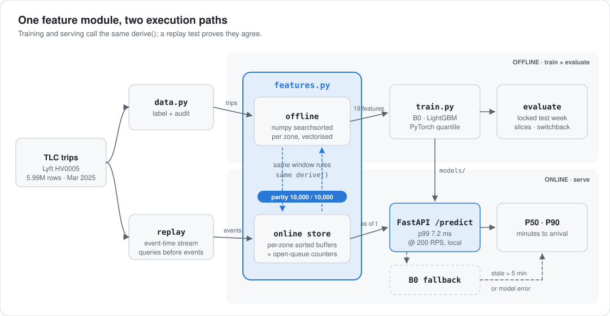
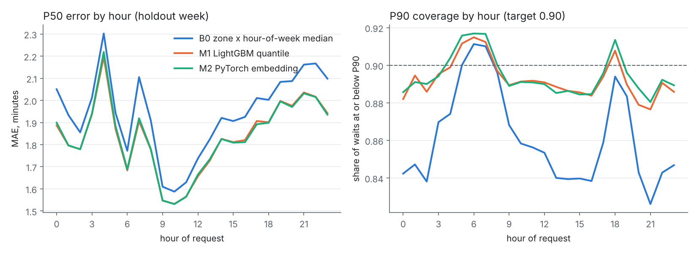
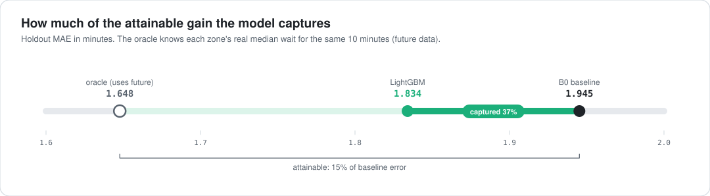
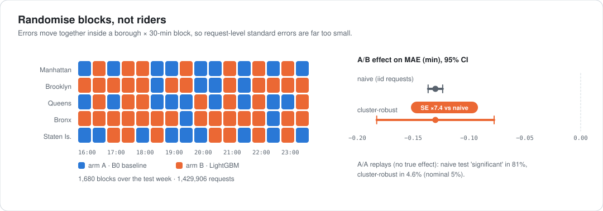
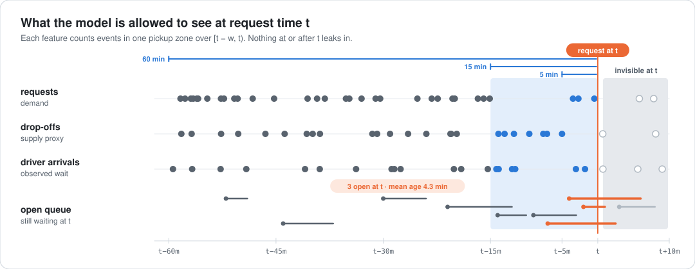

<div align="center">

# NYC Rideshare Pickup-ETA Service

**Calibrated P50 / P90 driver-arrival forecasts at request time, served in single-digit milliseconds.**
<br>Built on 5.99M public NYC TLC Lyft trips (March 2025), with point-in-time features shared by training and serving.

[](https://github.com/Jitesh-Mishra/nyc-rideshare-pickup-eta/actions/workflows/ci.yml)


| **−10.7%** | **89.2%** | **7.2 ms** | **10,000 / 10,000** |
|:---:|:---:|:---:|:---:|
| P90 pinball loss vs baseline | P90 coverage (baseline 86.0%) | p99 latency at 200 RPS, local | offline vs online feature parity |

</div>

---

## The system

<picture>
  <source media="(prefers-color-scheme: dark)" srcset="docs/img/architecture-dark.svg">
  
</picture>

Fulfillment decisions (which driver to offer, what ETA to quote) consume an ETA **distribution**, not a point. For every new ride request this service predicts the driver-arrival wait (`on_scene − request`). It returns P50 and P90 from signals a dispatcher actually has at that instant, and falls back to a historical baseline when the live feature stream goes stale.

The core design choice is that `features.py` is the only place features are defined. Training runs it vectorised over a month of history. Serving runs it incrementally over an in-memory store fed by an event stream. A replay test pushes the test week through the online path and checks every value against the offline one.

## Results

Locked holdout week, **Mar 25 to 31 2025, 1,429,974 requests, evaluated once** (`reports/test_runs.json`).

| Model | MAE (min) | vs B0 | P90 pinball | vs B0 | P90 coverage |
|---|---:|---:|---:|---:|---:|
| B0 global median | 2.040 | +5.0% | 0.635 | +6.3% | 89.4% |
| **B0 zone × hour-of-week median** (baseline) | 1.943 | | 0.597 | | 86.0% |
| M1 LightGBM quantile (served) | **1.835** | **−5.6%** | 0.533 | **−10.7%** | 89.2% |
| M2 PyTorch embeddings + pinball loss | **1.835** | **−5.6%** | **0.531** | **−11.1%** | **89.4%** |

<picture>
  <source media="(prefers-color-scheme: dark)" srcset="reports/figures/error_by_hour-dark.png">
  
</picture>

The baseline's P90 sags to 83 to 86% through the middle of the day and late evening. The quantile models stay close to the 90% target around the clock, which is what a downstream optimizer consuming P90 needs.

### 1. The headroom is small, so I measured it

<picture>
  <source media="(prefers-color-scheme: dark)" srcset="docs/img/headroom-dark.svg">
  
</picture>

A 5.6% MAE gain looks modest until you bound it. An oracle that already knows each zone's real median wait for the same 10 minutes (future data, so not a model) only gets 15% below the baseline. **LightGBM captures 37% of everything a zone-time signal could possibly capture.** The remaining error is per-trip: how far the matched driver happens to be. Public TLC data has no driver positions.

### 2. Real-time features earn their keep on bad days

| Day | Mean wait | B0 MAE | LightGBM MAE | Gain | P90 coverage B0 → LightGBM |
|---|---:|---:|---:|---:|---:|
| Tue to Fri (avg) | 4.0 min | 1.755 | 1.700 | −3.1% | 89.4% → 90.4% |
| Sat Mar 29 | 4.5 min | 1.954 | 1.849 | −5.4% | 85.1% → 88.9% |
| **Sun Mar 30** | **5.7 min** | 2.634 | 2.366 | **−10.2%** | **74.1% → 84.7%** |
| Mon Mar 31 | 4.4 min | 2.067 | 1.875 | −9.3% | 84.0% → 88.5% |

On Sunday Mar 30 waits ran about 40% above the rest of the week, all day. A historical median can't see that, but the live queue and recent-wait features can. The drift monitor flagged the day on its own (recent-wait PSI 1.54, P90 coverage alert). Full table: `reports/daily_errors.csv`.

### 3. Experimenting in a two-sided market

<picture>
  <source media="(prefers-color-scheme: dark)" srcset="docs/img/switchback-dark.svg">
  
</picture>

Rider-level A/B tests leak through shared driver supply, so marketplace teams randomise **time-space blocks** instead. Replaying the test week under a borough × 30-min switchback shows errors are strongly correlated within blocks. The cluster-robust SE is **7.4×** the naive one. Across 500 A/A replays, a naive test called a non-existent effect significant **81%** of the time, versus **4.6%** with clustering. The B0 vs LightGBM effect survives at −0.130 min, cluster CI [−0.183, −0.078].

## How the features avoid leakage

<picture>
  <source media="(prefers-color-scheme: dark)" srcset="docs/img/point-in-time-dark.svg">
  
</picture>

Every trip becomes time-stamped events in its zone, each stamped with when the event becomes *known*:

| Stream | Becomes known at | Features (per pickup zone) |
|---|---|---|
| requests | `request_datetime` | counts over 5 / 15 / 60 min (demand) |
| drop-offs | `dropoff_datetime` | counts over 15 / 60 min (a **supply proxy**; TLC has no driver GPS), demand/supply ratio |
| driver arrivals | `on_scene_datetime` | mean observed wait over the last 10 / 30 min |
| open queue | request until arrival | requests still waiting at t, and their mean age |
| static | always | zone, borough, airport flag, hour-of-week, minute of day, WAV request |

`trip_miles` and fares are excluded because they aren't known at request time. Two tests guard this. One checks the exact window boundaries. The other scrambles every event after a cutoff and asserts that no earlier feature moves (`tests/test_features.py`).

<details>
<summary><b>Data, label and split details</b></summary>

- **Source:** `fhvhv_tripdata_2025-03.parquet` filtered to `hvfhs_license_num = 'HV0005'` (Lyft): 5,989,698 trips, plus the taxi zone lookup. These are public NYC TLC records; nothing here describes Lyft's internal systems.
- **Label:** `on_scene − request` in minutes (driver arrival; boarding, a median 0.75 min, is excluded). For HV0005, `on_scene_datetime` is 99.7% null before Mar 6 and 0% after, so labelled rows start Mar 6 (4,973,533 rows). Negative waits (1.7%) are dropped; waits above 30 min (0.04%) are clipped. The median is 3.65 min and the P90 7.7 min.
- **Split:** train Mar 6 to 21 (2.94M) · validation Mar 22 to 24 (0.61M; early stopping, epoch selection, one feature iteration) · test Mar 25 to 31 (1.43M, run once).
- **Models:**
  - B0 is the zone × hour-of-week median and P90, with zone then global fallback.
  - M1 is LightGBM with quantile objective α = 0.5 and 0.9 (2M-row training sample, early stopping).
  - M2 is a PyTorch MLP (256 → 128) over zone / hour-of-week / borough embeddings plus 17 numeric inputs, trained with summed pinball loss. Its P90 head is P50 + softplus, so the quantiles never cross. This borrows the embed-categoricals and asymmetric-loss idea from Uber's DeepETA at toy scale; it isn't benchmarked against it.
- **Decisions and their trade-offs:** [`docs/decisions.md`](docs/decisions.md). Every experiment: [`reports/experiments.csv`](reports/experiments.csv).
</details>

<details>
<summary><b>Serving and latency</b></summary>

- `POST /events` ingests `request` / `dropoff` / `arrival` events into the in-memory store.
- `POST /predict {"zone": 161}` returns `p50_min`, `p90_min`, `model`, `fallback`, `feature_staleness_min`, `server_ms`.
- If the store's clock is more than 5 min behind the request, or the model throws, the response comes from the B0 baseline with `fallback: true` (tested in `tests/test_serving.py`).

Local load test (`scripts/latency_bench.py`): one uvicorn worker on a 2-core VM, open-loop, 6,000 requests per rate, with the client on the same host. Not a production number.

| Model | RPS | p50 | p95 | p99 | server compute p99 | errors |
|---|---:|---:|---:|---:|---:|---:|
| LightGBM | 50 | 3.9 ms | 5.9 ms | 10.5 ms | 3.2 ms | 0 |
| LightGBM | 100 | 3.2 ms | 4.6 ms | 6.9 ms | 2.4 ms | 0 |
| LightGBM | 200 | 3.1 ms | 4.4 ms | **7.2 ms** | 2.3 ms | 0 |
| PyTorch | 200 | 3.5 ms | 5.6 ms | 12.9 ms | 4.6 ms | 0 |
</details>

<details>
<summary><b>Where it breaks</b> (sliced holdout errors)</summary>

| Slice | B0 MAE | LightGBM MAE | LightGBM P90 coverage |
|---|---:|---:|---:|
| Airports (JFK, LGA, EWR) | 3.677 | 3.405 | 89.2% |
| Queens | 2.204 | 2.082 | 88.8% |
| Staten Island | 2.279 | 2.148 | 88.0% |
| Evening 20 to 23h | 2.130 | 1.995 | 88.3% |
| Manhattan | 1.804 | 1.706 | 89.6% |

Full table: `reports/sliced_errors.csv`. The next fix is conformal recalibration of P90 per borough.
</details>

## Run it

```bash
pip install -r requirements.txt
export PYTHONPATH=src
python -m eta.train                      # features, B0 / LightGBM / PyTorch, validation, one test run (about 5 min, 2 CPUs)
python -m eta.parity                     # offline vs online replay on 10k test requests
python -m eta.switchback && python -m eta.monitor
python scripts/latency_bench.py          # local load test at 50 / 100 / 200 RPS
pytest -q                                # leakage, parity, serving tests (synthetic fixture, no data needed)
```

Serve it:

```bash
ETA_REPLAY_UNTIL=2025-03-27T18:00:00 uvicorn eta.serve:app        # store warmed by replaying 2 h of events
curl -s -X POST localhost:8000/predict -H 'content-type: application/json' -d '{"zone": 161}'
```

`data/` holds the Lyft-only extract (4 weekly parquet files, 110 MB). To rebuild it from the TLC site, run `scripts/prepare_data.sh`. A `Dockerfile` is included; it has not been built or smoke-tested yet.

<details>
<summary><b>Repository layout</b></summary>

```
src/eta/
  data.py         load trips, build label, audit
  features.py     point-in-time features: offline (vectorised) + OnlineFeatureStore + replay streamer
  models.py       B0, LightGBM quantile, PyTorch embedding quantile net, metrics
  train.py        end-to-end training and the single locked test evaluation
  serve.py        FastAPI service with stale-feature and error fallback
  parity.py       offline vs online replay check
  switchback.py   borough x 30-min switchback replay, naive vs cluster-robust SE
  monitor.py      daily PSI on top features + P90 coverage drift
scripts/          latency benchmark, figures, diagrams, data prep
reports/          every number in this README (results, slices, parity, latency, switchback, monitoring)
docs/             decisions, interview probe prep, diagrams
```
</details>

## Limitations

- **Completed trips only.** Cancels and declines are invisible, so waits that ended in a cancel are censored and the open-queue feature undercounts the real queue.
- **The supply signal is a proxy.** Drop-offs into a zone stand in for available drivers. Without driver locations, per-trip distance (the biggest error source) is out of reach.
- **The replay is not live traffic.** Latency is a single-process local test with the client on the same host.
- **The switchback measures correlation, not interference.** Predictions here don't change driver behaviour; measuring spillover needs a dispatch simulator.
- **One city, one month.**

## Next

Conformal P90 recalibration per borough · a 15/30/60-min zone demand nowcast head reusing `features.py` · a toy dispatch simulator so switchbacks measure interference · a second month for drift · a deployed demo endpoint.

---

<sub>**Stack:** Python, PyTorch, LightGBM, DuckDB, Polars, FastAPI, Docker, pytest, GitHub Actions · deep learning, feature pipelines, model training workflows, serving infrastructure, real-time applications. Data: NYC TLC Trip Record Data (public). Diagrams are generated from `reports/` by `scripts/make_diagrams.py`.</sub>
