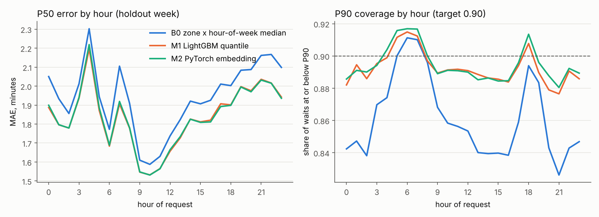
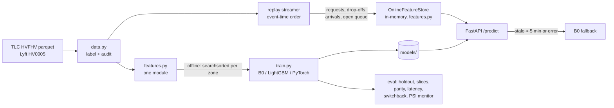

# NYC Rideshare Pickup-ETA Service

Real-time driver-arrival forecaster for 5.99M public NYC TLC Lyft trips (March 2025). It has point-in-time zone demand, supply-proxy and open-queue features that are shared by training and serving, quantile (P50/P90) LightGBM and PyTorch models, and a FastAPI service measured under load.


## Results (locked holdout week, Mar 25 to 31 2025, 1,429,974 requests, run once)

| Model | MAE (min) | vs B0 | P90 pinball | vs B0 | P90 coverage |
|---|---|---|---|---|---|
| B0 global median | 2.040 | +5.0% | 0.635 | +6.3% | 89.4% |
| **B0 zone x hour-of-week median** (baseline) | 1.943 | | 0.597 | | 86.0% |
| M1 LightGBM quantile (P50, P90) | 1.835 | **-5.6%** | 0.533 | **-10.7%** | 89.2% |
| M2 PyTorch embeddings + pinball loss | 1.835 | **-5.6%** | 0.531 | **-11.1%** | 89.4% |

| System check | Result | Evidence |
|---|---|---|
| Offline vs online feature parity | 10,000 / 10,000 sampled test requests identical on all 19 features | `reports/parity.json` |
| Leakage tests | window-boundary test + future-scramble test pass | `tests/test_features.py` |
| Serving latency, LightGBM, 200 RPS | p50 3.1 ms, **p99 7.2 ms** round trip (server compute p99 2.3 ms), 0 errors | `reports/latency_lgb.json` |
| Serving latency, PyTorch, 200 RPS | p50 3.5 ms, p99 12.9 ms round trip | `reports/latency_torch.json` |
| Switchback replay, borough x 30-min blocks (1,680) | cluster-robust SE **7.4x** naive SE; naive A/A false-positive rate 81% vs 4.6% | `reports/switchback.json` |
| Drift monitor | flags Sun Mar 30 (recent-wait PSI 1.54, P90 coverage 84.7%) | `reports/monitoring.json` |

Latency is from a local load test: one uvicorn worker on a 2-core cloud VM, with the client on the same host.



### What the numbers say
1. **The headroom is small, and the models capture about a third of it.** An oracle that already knows each zone's actual median wait in the same 10-minute block (future information, so not a model) reaches 1.648 MAE. So no zone-time signal can beat B0 by more than about 15%. LightGBM captures 37% of that gap (`reports/headroom.json`). Most of the remaining error is per-trip (how far the matched driver is), and public TLC data doesn't contain it.
2. **Calibration is the bigger win.** The baseline's P90 under-covers (86.0%, and 74.1% on the shock day). The quantile models hold 89% overall. An optimizer that consumes P90 cares more about that than about the 6% MAE gain.
3. **Real-time features pay off under shocks.** On Sun Mar 30, waits ran about 40% above the rest of the week all day. LightGBM beat B0 by 10.2% that day versus about 3% on normal weekdays (`reports/daily_errors.csv`).
4. **PyTorch ties LightGBM** on P50 and is marginally better on P90. I serve LightGBM because its p99 is lower.

## Problem
Fulfillment decisions (which driver to offer, what ETA to quote) consume an ETA *distribution*, not a point. This project forecasts the driver-arrival wait (`on_scene - request`) for each new request, at request time, from signals a dispatcher actually has at that instant. It returns P50 and P90 under a latency budget, and falls back to a baseline when features go stale.

## Architecture


## Approach
- **Data:** `fhvhv_tripdata_2025-03.parquet` filtered to `hvfhs_license_num = 'HV0005'` (Lyft), 5,989,698 trips, plus the taxi zone lookup. These are public NYC TLC records. They say nothing about Lyft's internal systems.
- **Label:** `on_scene_datetime - request_datetime` (driver arrival, boarding excluded). For HV0005, `on_scene_datetime` is 99.7% null before Mar 6 and 0% null after, so labelled rows start Mar 6. Rows with negative waits (1.7%) are dropped and the label is clipped to 30 min (0.04% above). Median 3.65 min, P90 7.7 min (`reports/data_audit.json`).
- **Split (chronological):** train Mar 6 to 21 (2.94M), validation Mar 22 to 24 (0.61M, early stopping and model selection), test Mar 25 to 31 (1.43M, evaluated once; `reports/test_runs.json`).
- **Features** (`src/eta/features.py`), all computed over `[t - w, t)` per pickup zone:
  - request counts over 5/15/60 min (demand)
  - drop-offs into the zone over 15/60 min (a **supply proxy**: TLC has no driver GPS)
  - demand/supply ratio
  - mean observed wait over the last 10/30 min (from drivers who arrived before t)
  - open queue: requests still waiting at t, and their mean age
  - zone, borough, airport flag, hour-of-week, minute of day, WAV request
  - `trip_miles` and fares are excluded because they aren't known at request time.
- **Models:**
  - B0 is the zone x hour-of-week median and P90 (falling back to zone, then global).
  - M1 is two LightGBM quantile models (alpha 0.5, 0.9) trained on a 2M-row sample.
  - M2 is a PyTorch MLP with zone/hour-of-week/borough embeddings and a summed pinball loss. Its P90 head is P50 + softplus, so the quantiles never cross. The design borrows the embed-categoricals and asymmetric-loss idea from Uber's DeepETA at a much smaller scale; it is not a reproduction or a benchmark of it.
- **Serving** (`src/eta/serve.py`): `/events` ingests stream events, `/predict` reads the online store and runs the model, and the service falls back to B0 when features are stale or the model errors.
- **Switchback** (`src/eta/switchback.py`): assigns borough x 30-min blocks to arms. A/A replays measure how much naive request-level SEs understate uncertainty, and one A/B replay (B0 vs LightGBM) reports both SEs.

## How to run
```bash
pip install -r requirements.txt
export PYTHONPATH=src
python -m eta.train                  # features, B0, LightGBM, PyTorch, val, one test run (about 5 min on 2 CPUs)
python -m eta.parity && python -m eta.switchback && python -m eta.monitor
python scripts/latency_bench.py --rps 50 100 200     # local load test
pytest -q                                            # leakage, parity, serving tests (synthetic fixture)
```
Serve: `ETA_REPLAY_UNTIL=2025-03-27T18:00:00 uvicorn eta.serve:app`, then `curl -X POST localhost:8000/predict -H 'content-type: application/json' -d '{"zone":161}'`. Or use `docker build -t eta . && docker run -p 8000:8000 eta`.

To rebuild `data/` from the TLC site, see `scripts/prepare_data.sh`.

## Limitations
- Completed trips only. Cancels and declines are invisible, so long waits that ended in a cancel are censored out, and the open-queue feature undercounts the real queue.
- The supply signal is a proxy (drop-offs into the zone). There are no driver locations, which is the main driver of per-trip error.
- The replay is not live traffic. Latency comes from a single-process local test with the client on the same host.
- The switchback measures error correlation within blocks, not interference. Predictions here don't change driver behaviour, so this shows experimental design only; measuring spillover needs a dispatch simulator.
- The data covers one city and one month of history.

## What I'd do next
Conformal recalibration of P90 per borough (the shock day under-covers), a 15/30/60-min zone demand nowcast head reusing `features.py`, a toy dispatch simulator so switchbacks measure real interference, and a second month for drift.

**Stack:** Python, PyTorch, LightGBM, DuckDB, Polars, FastAPI, Docker, pytest, GitHub Actions; deep learning, feature pipelines, model training workflows, serving infrastructure, real-time applications.
